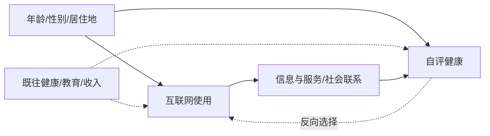
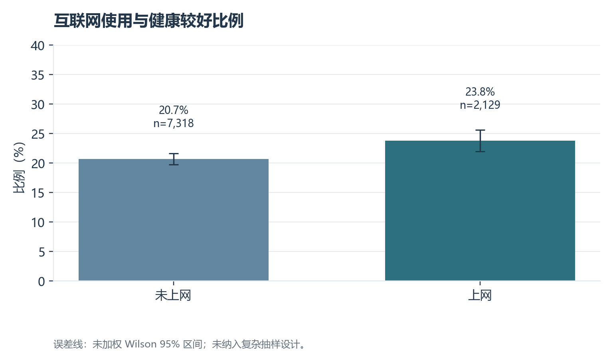
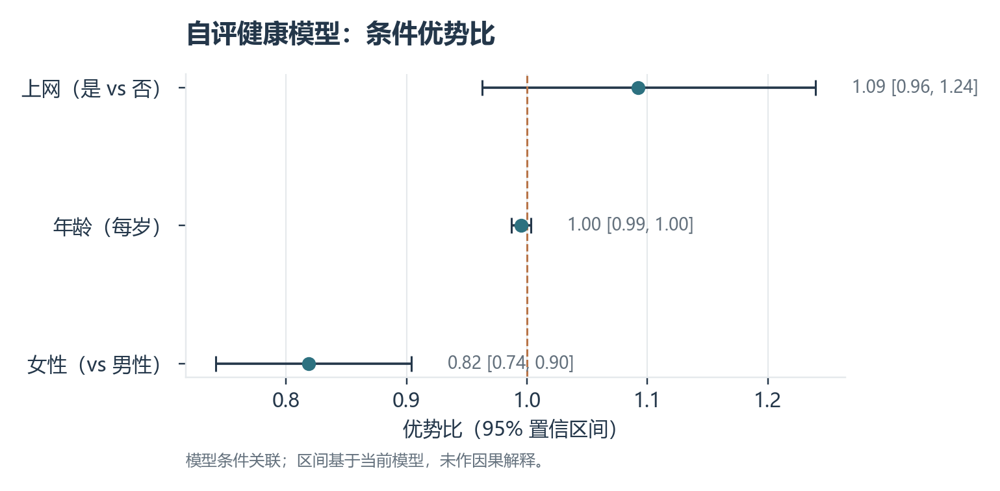
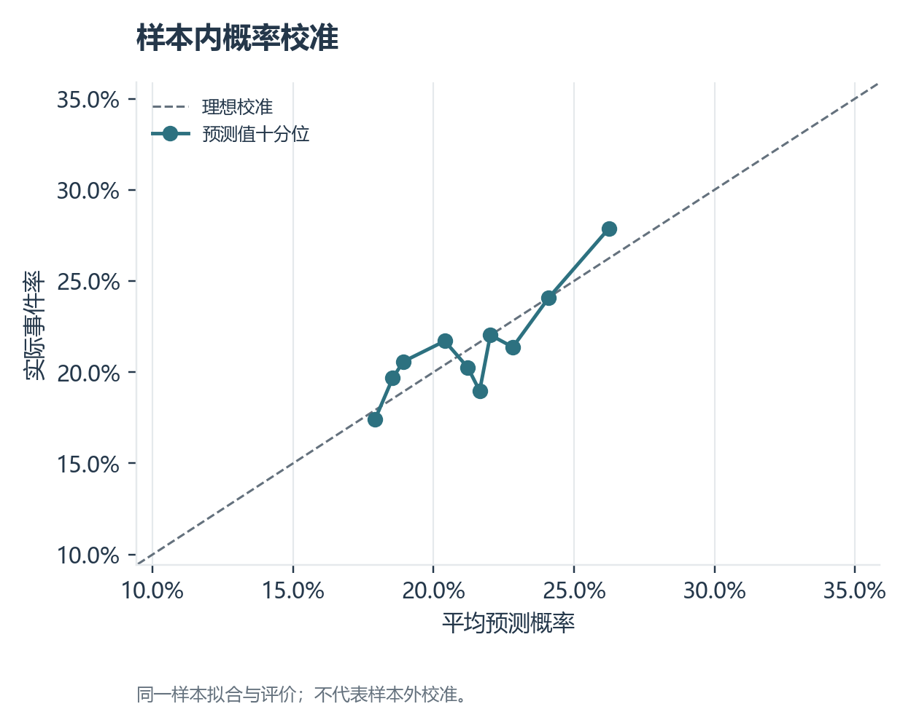
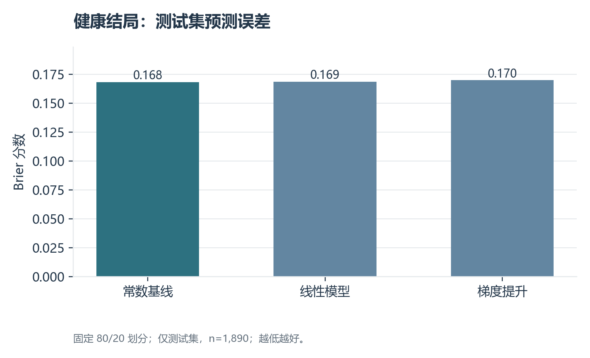

# 老年人互联网使用与自评健康：基于 CHARLS 2020 的关联、倾向评分与预测分析

**摘要：** 本文利用 CHARLS 2020 年数据，研究中国 60 岁及以上受访者互联网使用与自评健康的关系。对 10,638 名符合年龄条件者进行变量清理后，获得 9,447 个完整案例。首先进行分组描述及 Logistic 回归；随后以年龄、性别和居住地类别估计上网倾向评分，开展截尾逆概率加权的探索性对比；最后在固定的 80/20 训练—测试划分上比较常数、正则化 Logistic 和直方图梯度提升模型。未调整的健康较好比例为上网组 23.77%、未上网组 20.66%；回归优势比约 1.09（$p=0.171$）。加权差异接近零，且平衡与重叠诊断提示不能将其解释为可信因果效应。测试集上复杂模型未优于常数基线。研究显示数字使用与健康的表面关联可能受到人群构成影响，现有变量也不足以对个体健康作有效预测。

**关键词：** 老年健康；数字鸿沟；CHARLS；倾向评分；梯度提升

## 一、研究问题

互联网逐渐成为获取信息和服务的渠道，老年人是否上网可能与健康状况相关。本报告考察中国 60 岁及以上受访者中，互联网使用者和未使用者的自评健康是否存在差异，以及控制年龄、性别和居住地类别后，这种差异是否仍然明显。分析只描述关联，不作因果推断。

## 研究框架与可检验假设

互联网使用可能通过获取健康信息、社会联系和线上服务与自评健康相关；健康状况也可能反过来影响上网能力和意愿。年龄、教育、收入、居住地及既往健康可能同时影响两者。本文预期未调整组间差异存在，但在控制可观测背景后关联减弱。以下图展示分析所关心的路径；虚线所代表的既往健康和社会经济地位在当前模型中未充分测量。



目标总体限定为数据中 60 岁及以上的受访者。若要识别“上网”的平均处理效应，需明确定义可操作的上网干预，并假设一致性、条件可交换性、正值性和无干扰。尤其是既往健康未被充分控制，条件可交换性很难成立。因此下文的加权差异是**倾向评分调整后的关联**，不是已识别的因果效应。

## 二、数据来源与样本

数据来自项目附带的中国健康与养老追踪调查（CHARLS）2020 年全国追踪调查。使用 `Health_Status_and_Functioning.dta` 和 `Demographic_Background.dta`，按受访者 `ID` 一对一合并。健康模块原有 19,367 条记录、936 个变量，满足作业要求的样本量和变量数门槛；本题只选取与研究问题相关的变量。数据与问卷、编码说明见 `../data/CHARLS数据合集/CHARLS 2020年全国追踪调查/`。

筛选 60 岁及以上受访者后有 **10,638 人**；进一步剔除分析变量缺失者，得到 **9,447 人**。在老年样本中，自评健康缺失 1,178 人、上网情况缺失 7 人、居住地类别缺失 12 人；同一人可能同时缺失多个变量，因此不能直接相加推算完整案例数。分析采用完整案例，未使用调查权重。

| 变量 | 原始字段 | 本报告处理方式 |
|---|---|---|
| 年龄 | `xrage` | 保留 60–110 岁，连续变量 |
| 是否上网 | `da040` | 1=使用，2=不使用 |
| 自评健康 | `da001` | 有效值 1–5；1、2 记为“健康较好”，3–5 记为其他 |
| 性别 | `xrgender` | 1=男，2=女 |
| 居住地类别 | `ba008` | 保留 1–3，回归中作为分类变量 |

自评健康中的 997 等特殊编码不作为有效回答。上述变量既有定量变量，也有定性变量。完整的处理过程见 [分析脚本](analyze.py)，缺失数量见 [缺失统计](output/missingness.csv)。

## 三、变量分布与数据质量

### 数值字段描述统计

下表对最终完整案例计算，`N` 为该字段的有效观测数；`P25`、`P50`、`P75` 分别为第 25、50、75 百分位。二元变量的均值等于取值为 1 的样本比例；有序类别的均值仅为编码描述，不假定相邻选项距离相等。

| 字段 | N | Mean | SD | Min | P25 | P50 | P75 | Max |
|---|---:|---:|---:|---:|---:|---:|---:|---:|
| 年龄（岁） | 9,447 | 68.35 | 6.25 | 60.00 | 63.00 | 67.00 | 72.00 | 108.00 |
| 使用互联网（0/1） | 9,447 | 0.23 | 0.42 | 0.00 | 0.00 | 0.00 | 0.00 | 1.00 |
| 自评健康原分（1–5） | 9,447 | 3.05 | 1.01 | 1.00 | 3.00 | 3.00 | 4.00 | 5.00 |
| 健康较好（0/1） | 9,447 | 0.21 | 0.41 | 0.00 | 0.00 | 0.00 | 0.00 | 1.00 |
| 女性（0/1） | 9,447 | 0.52 | 0.50 | 0.00 | 0.00 | 1.00 | 1.00 | 1.00 |

原始精度数值见[数值描述统计 CSV](output/numeric_descriptives.csv)。


下表报告 9,447 个完整案例的分类频数和百分比。完整分布可由 [变量分布表](output/variable_distribution.csv) 复核。

| 变量 | 分类或统计量 | 数值 |
|---|---|---:|
| 是否上网 | 是 / 否 | 2,129（22.54%）/ 7,318（77.46%） |
| 自评健康较好 | 是 / 否 | 2,018（21.36%）/ 7,429（78.64%） |
| 性别 | 女 / 男 | 4,866（51.51%）/ 4,581（48.49%） |
| 居住地类别 | 编码 1 / 2 / 3 | 2,173（23.00%）/ 1,003（10.62%）/ 6,271（66.38%） |

完整案例占 60 岁及以上原始样本的 88.81%。居住地类别保留原始编码，未在缺乏进一步核验时自行赋予城乡含义。表中的分类百分比均以完整案例为分母；缺失统计则以筛选后的 10,638 人为分母。

## 四、描述性结果

| 是否使用互联网 | 人数 | 平均年龄 | 健康较好比例 | 自评健康平均分 |
|---|---:|---:|---:|---:|
| 不使用 | 7,318 | 69.15 岁 | 20.66% | 3.08 |
| 使用 | 2,129 | 65.58 岁 | 23.77% | 2.93 |

上网组的“健康较好”比例比未上网组高 **3.11 个百分点**，但上网组平均年龄也低约 **3.58 岁**。简单分组差异可能受到年龄及其他背景因素影响。这里的健康分数越低代表选项越靠近较好的健康等级。



*图 1. 分组比例、人数和未加权 Wilson 95% 区间；未处理复杂抽样设计。*

## 五、调整后的关联

### 模型设定

设 $Y_i=1$ 表示受访者自评健康较好，$I_i=1$ 表示使用互联网。采用二元 Logistic 模型：

$$\operatorname{logit}[P(Y_i=1)]=\beta_0+\beta_1 I_i+\beta_2\mathrm{Age}_i+\beta_3\mathrm{Female}_i+\boldsymbol{\gamma}^{\top}\mathrm{Residence}_i.$$

使用最大似然估计，报告系数、95% 置信区间和双侧 $p$ 值。$\exp(\beta_1)$ 是在模型变量相同条件下的优势比。图表与模型均为未加权估计；该式是关联模型，并不满足识别因果效应所需的条件。


使用 Logistic 回归，以“健康较好”为因变量，以是否上网为主要解释变量，纳入年龄、性别和居住地类别。上网变量的回归系数为 **0.088**，对应优势比约 **1.09**；其 95% 置信区间对应的优势比约为 **0.96–1.24**，`p=0.171`。按通常的 5% 显著性水平，当前模型没有足够证据认定控制这些变量后，上网与健康较好之间存在统计显著关联。完整估计见 [回归系数表](output/logit_coefficients.csv)。



*图 2. 优势比及 95% 模型置信区间；虚线为优势比 1。系数是条件关联。*

这是一个较简化的模型。教育、收入、慢性病、既往健康以及家庭支持等都可能同时关联上网和健康，尚未纳入。因此，模型结果不能解释为“上网改善健康”或“上网无益”。

## 六、样本内拟合与标准化预测

| 指标 | 结果 | 含义 |
|---|---:|---|
| McFadden 伪 $R^2$ | 0.0036 | 相对只有截距的模型，解释改善很小；不能按线性回归 $R^2$ 解读 |
| AUC | 0.540 | 样本内区分两类健康结局的能力较弱 |
| Brier 分数 | 0.1673 | 样本内概率预测均方误差，越低越好 |
| AIC | 9,777.60 | 仅适合与同一结局、同一分析样本的候选模型比较 |

[模型拟合指标](output/model_fit.csv)和[十分位校准表](output/calibration.csv)均基于**训练模型使用的同一批样本**。图 2 对比分组平均预测概率与实际比例；它只能辅助检查样本内校准，不能证明对新样本的预测能力。



*图 3. 按样本内预测概率十分位汇总；虚线表示预测与观察完全一致。*

为便于解释，将每位受访者的上网状态分别设为“否”和“是”，其余观察到的协变量保持原值，再对预测概率取平均。这是**模型标准化情景预测**，并非干预效果：

| 统一设定的上网状态 | 平均预测“健康较好”概率 |
|---|---:|
| 否 | 21.01% |
| 是 | 22.51% |

两种情景相差约 **1.50 个百分点**。[预测结果表](output/standardized_predictions.csv)给出精确值；未对该差值计算置信区间，因此不应据此宣称差异显著。未做训练集/测试集划分、交叉验证或外部验证。

## 七、倾向评分加权与识别诊断

为检验可测混杂的影响，以年龄、性别、居住地类别拟合二元 Logistic 倾向模型 $e(X)=P(I=1\mid X)$。使用逆概率权重 $I/e(X)+(1-I)/(1-e(X))$，将倾向值截在 0.05–0.95，并用加权均值之差作探索性对比。采用 HC3 稳健标准误；**区间未纳入倾向评分估计误差**，不能视作完整的因果推断区间。

| 诊断或结果 | 数值 |
|---|---:|
| 处理组 / 对照组 | 2,129 / 7,318 |
| 倾向分数第 1 / 99 百分位 | 0.013 / 0.743 |
| 被截尾的观测数 | 996 |
| 处理组 / 对照组有效样本量 | 约 1,286 / 6,636 |
| 最大绝对标准化均差：加权前 → 加权后 | 0.692 → 0.130 |
| 加权健康较好比例差 | −0.17 个百分点 |
| 条件性 HC3 95% 区间 | −2.47 至 2.12 个百分点 |

详情见 [倾向评分诊断](output/ipw_diagnostics.json)与[协变量平衡表](output/ipw_balance.csv)。加权后最大标准化均差仍为 0.130，常用的 0.1 平衡参考阈值未达到；低倾向区域也存在重叠性压力。更关键的是，教育、收入和既往健康没有进入倾向模型。因此“接近零”的加权差异只说明已测变量调整后的关联，不排除重要未测混杂或反向因果。

## 八、独立测试集上的预测比较

按固定随机种子 20261109 将样本分成训练集 7,557 人、测试集 1,890 人，并按结局分层。仅用训练集拟合三种模型：训练集事件率常数预测、标准化/独热编码后的正则化 Logistic 回归、直方图梯度提升分类器。预处理置于训练流水线内，测试集未参与拟合。所有模型使用相同的年龄、性别、居住地和上网变量；该比较评价的是**预测能力**，不提供因果识别。

| 模型 | 测试 AUC | 测试 Brier 分数 | 测试对数损失 |
|---|---:|---:|---:|
| 常数基线 | 0.500 | **0.1681** | **0.5189** |
| 正则化 Logistic | 0.509 | 0.1685 | 0.5202 |
| 直方图梯度提升 | 0.515 | 0.1697 | 0.5239 |



*图 4. 三种模型在相同测试集上的 Brier 分数；越低越好。*

结果见 [测试集模型比较](output/holdout_models.csv)。梯度提升的 AUC 略高，但概率误差和对数损失反而更差；现有变量的个体层面预测信息很弱。这里仅做一次划分，未进行重复交叉验证、超参数搜索或外部验证，因此模型排名也有抽样波动。深度网络在这种低维表格和有限有效变量下未必合理，增加复杂度不能替代信息质量。

## 九、结论与局限

样本中，上网老年人的自评健康较好比例略高；调整年龄、性别和居住地类别后，这一关联较弱且未达到 5% 显著性水平。数字鸿沟值得讨论，但本数据分析不足以确认互联网使用对健康的作用方向或大小。

主要局限包括：横截面观察难以区分健康影响上网与上网影响健康；完整案例删除可能带来选择偏差；自评健康是主观指标；未应用抽样权重、复杂抽样设计和更多混杂变量。因此，此处数字适合作为课堂探索性结果，不应直接外推为全国老年人口比例。

## 十、复现

在项目根目录依次运行以下命令，以重建主分析及留出集/倾向评分结果：

```bash
/opt/anaconda3/envs/myenv/bin/python 01_数字鸿沟与老年健康/analyze.py
/opt/anaconda3/envs/myenv/bin/python src/advanced_analysis.py
```

脚本在本目录 `output/` 生成分析样本、分组统计、回归结果和图片。适合在 PPT 中依次展示研究问题、数据与预处理、分组图、调整后模型及局限。

## 十一、数据文献与材料

- 中国健康与养老追踪调查（CHARLS），[2020 年用户手册](<../data/CHARLS数据合集/CHARLS 2020年全国追踪调查/用户手册CHARLS_2020_User_Guide_Chinese.pdf>)、[2020 年编码参考书](<../data/CHARLS数据合集/CHARLS 2020年全国追踪调查/数据编码参考书CHARLS_2020_Codebook.pdf>)及项目附带的 2020 年数据。变量编码以本地数据标签和编码材料为准。
- 本报告统计、表格和图形由本目录 `analyze.py` 对上述数据计算生成。引用本报告结果时应注明“CHARLS 2020，作者计算，未加权”。


## 十二、方法参考文献

- Rosenbaum, P. R., & Rubin, D. B. (1983). [The central role of the propensity score in observational studies for causal effects](https://doi.org/10.1093/biomet/70.1.41). *Biometrika*, 70(1), 41–55. 本文借鉴倾向评分与协变量平衡的分析框架。
- Hernán, M. A., & Robins, J. M. [*Causal Inference: What If*](https://miguelhernan.org/whatifbook). 本文据此区分潜在结果、识别假设与观察性关联。
- Friedman, J. H. (2001). [Greedy function approximation: A gradient boosting machine](https://doi.org/10.1214/aos/1013203451). *The Annals of Statistics*, 29(5), 1189–1232. 本文的梯度提升预测比较属于该类方法；具体实现使用 scikit-learn 的直方图算法。
