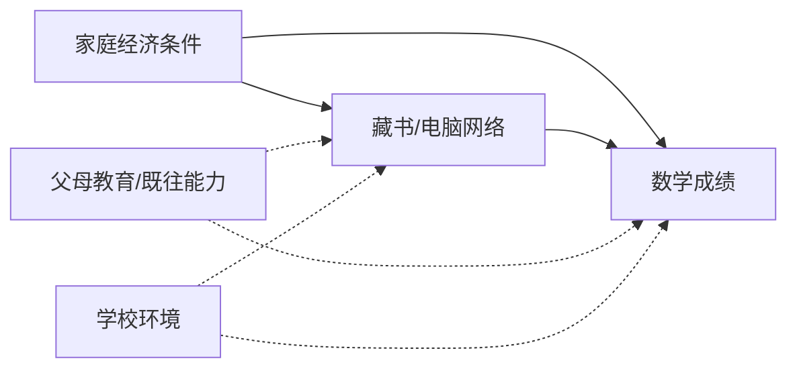
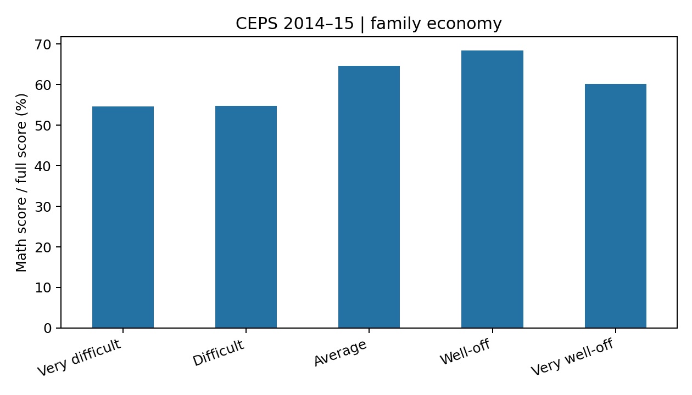
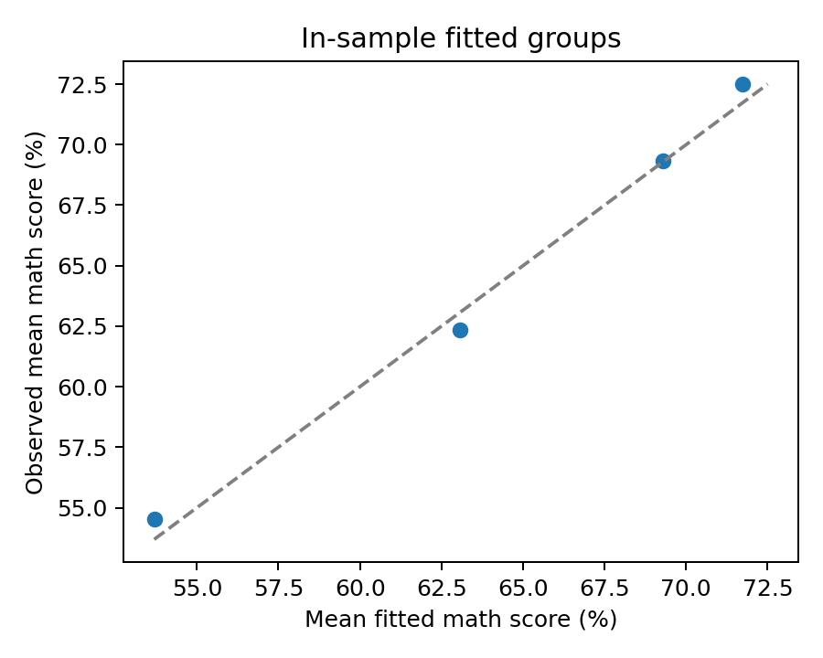

# 家庭学习资源与数学成绩差异：基于 CEPS 2014–15 的关联、倾向评分与机器学习比较

**摘要：** 本文使用 CEPS 2014–15 追访学生问卷，考察家庭经济条件、藏书和电脑网络资源与数学期中成绩的关系。在 10,750 名学生中获得 8,789 个完整案例。研究结合分组描述、HC3 稳健 OLS、以家庭经济和藏书为协变量的逆概率加权，以及训练—测试划分下的线性模型和直方图梯度提升模型。样本中家庭经济条件较好的组通常有更高的网络覆盖率和数学均分；控制家庭经济与藏书后，家有电脑和网络对应的 OLS 分差约 7.35 个百分点。加权差异约 8.53 个百分点，但家庭学习资源选择并非随机，父母教育等混杂未被控制。测试集最佳模型的 $R^2$ 仅约 0.077，说明当前变量难以准确预测个体成绩。

**关键词：** 教育公平；家庭资源；CEPS；数学成绩；梯度提升

## 一、研究问题

家庭经济条件、家庭藏书和电脑网络资源可能与学生的学习成绩相关。本报告以数学期中考试成绩为例，描述不同家庭经济条件学生的成绩差异，并在回归中同时纳入藏书和电脑网络资源。报告关注群体差异及统计关联，不将相关关系解释为因果效应。

## 研究框架与可检验假设

家庭经济状况可能影响图书、电脑和网络的可得性，家庭学习环境与成绩相关；父母教育、学校质量和学生既往能力又可能同时影响资源与成绩。本文检验资源与成绩的条件关联，预期家庭藏书和网络资源较多的学生平均成绩较高。经济条件也可能通过资源渠道影响成绩，因而将经济条件、藏书与网络资源同时放入回归时，经济条件系数不等于其“总影响”。



如将“家有电脑和网络”视为处理，目标量可写成学生样本中的平均成绩差 $E[Y(1)-Y(0)]$。然而“拥有资源”不是标准化的随机干预，资源质量、使用方式和获得时间不一致；父母教育、既往成绩等未观测因素使条件可交换性难以成立。因此本文的加权估计仅作敏感性参照，不称为教育资源的因果收益。

## 二、数据来源与样本

数据来自项目附带的中国教育追踪调查（CEPS）2014–15 年追访学生问卷 `cepsw2studentCN.dta`，原始样本 **10,750 人、311 个变量**，符合课程对样本数和变量数的要求。数据和使用手册见 `../data/CEPS数据合集/CEPS14-15追访/`。本题选取数学成绩、家庭经济条件、藏书和网络资源等变量。原始 Stata 中文选项标签有编码问题，脚本先修复标签，再执行分类映射。

数学成绩按 `w2mat / w2upmat × 100` 转为满分百分比，保留 0–100 的有效值。对主要分析变量采用完整案例后，样本为 **8,789 人**。在原始样本中，数学百分比缺失或无效 898 人、家庭经济条件缺失 893 人、藏书缺失 876 人、电脑网络资源缺失或无法映射 1,678 人；这些人数可能重叠。学生截面权重 `w2sweight` 保留在输出样本中，但目前的统计与回归未加权。

| 变量 | 原始字段 | 本报告处理方式 |
|---|---|---|
| 数学成绩百分比 | `w2mat`, `w2upmat` | 实得分除以满分，乘 100 |
| 家庭经济条件 | `w2a09` | 非常困难、比较困难、中等、比较富裕、很富裕 |
| 家庭藏书 | `w2a11` | 很少、比较少、一般、比较多、很多 |
| 家庭电脑与网络 | `w2a12` | 同时有电脑和网络为 1，其余有效选项为 0 |

## 三、变量分布与数据质量

下表使用 8,789 个完整案例。连续变量报告均值和标准差，分类变量报告人数及占比；完整结果见 [变量分布表](output/variable_distribution.csv)。

| 变量 | 分类或统计量 | 数值 |
|---|---|---:|
| 数学成绩百分比 | 均值 ± 标准差 | 63.53 ± 25.90 分 |
| 家庭经济条件 | 非常困难 / 比较困难 / 中等 | 259（2.95%）/ 1,058（12.04%）/ 6,423（73.08%） |
| 家庭经济条件 | 比较富裕 / 很富裕 | 979（11.14%）/ 70（0.80%） |
| 家庭藏书 | 很少 / 比较少 / 一般 | 1,099（12.50%）/ 1,261（14.35%）/ 3,350（38.12%） |
| 家庭藏书 | 比较多 / 很多 | 1,990（22.64%）/ 1,089（12.39%） |
| 家有电脑和网络 | 是 / 否 | 6,242（71.02%）/ 2,547（28.98%） |

完整案例占原始样本的 81.76%。很富裕组仅占 0.80%，该组均值和回归系数的不确定性需要特别强调。各变量缺失人数可能交叠，详细数据见 [缺失统计](output/missingness.csv)。

## 四、不同家庭经济条件的描述性差异

| 家庭经济条件 | 人数 | 平均数学成绩百分比 | 有电脑和网络比例 |
|---|---:|---:|---:|
| 非常困难 | 259 | 54.60% | 22.39% |
| 比较困难 | 1,058 | 54.83% | 30.62% |
| 中等 | 6,423 | 64.62% | 75.56% |
| 比较富裕 | 979 | 68.38% | 95.91% |
| 很富裕 | 70 | 60.19% | 97.14% |

从“非常困难”到“比较富裕”，平均数学成绩和家庭电脑网络覆盖率总体上升。“很富裕”组的平均成绩低于“比较富裕”组，但该组仅 **70 人**，均值不稳定，不宜据此断言富裕程度与成绩呈倒 U 形关系。家庭经济条件为学生自评，也可能存在分组误差。



## 五、同时考虑家庭资源的回归结果

### 模型设定

令 $Y_i$ 为数学成绩百分比，$E_i$ 为家庭经济条件分类，$B_i$ 为家庭藏书分类，$N_i$ 为家有电脑和网络指示变量。估计：

$$Y_i=\beta_0+\boldsymbol{\beta}_E^{\top}E_i+\boldsymbol{\beta}_B^{\top}B_i+\beta_NN_i+\varepsilon_i.$$

使用普通最小二乘法，并采用 HC3 异方差稳健标准误。参照类别分别是“非常困难”和“藏书很少”；分类变量系数表示相对参照组的条件平均分差。模型未加入学校、班级和父母教育等可能重要的协变量，结果应视作关联而非因果估计。


以数学成绩百分比为因变量，使用普通最小二乘回归，加入家庭经济条件、家庭藏书和电脑网络资源，采用 HC3 稳健标准误。家庭经济条件以“非常困难”为参照，家庭藏书以“很少”为参照。

在控制其余模型变量后，“有电脑和网络”对应的数学成绩约高 **7.35 个百分点**（95% 置信区间 **5.94–8.75**，`p<0.001`）。相对“藏书很少”，藏书“比较多”和“很多”对应的成绩分别高约 **12.47** 和 **13.42 个百分点**（均 `p<0.001`）。家庭经济条件各组相对“非常困难”组的系数在 5% 水平下均未显著。完整估计和不确定性见 [回归系数表](output/ols_coefficients.csv)。

这些系数描述条件关联。家庭网络与藏书可能同时反映收入、父母教育、学习环境等未测量因素；不能单独解释为购置电脑或增加图书能够提高相应分数。

## 六、样本内拟合与标准化预测

| 指标 | 结果 | 含义 |
|---|---:|---|
| $R^2$ / 调整后 $R^2$ | 0.0685 / 0.0675 | 模型解释约 6.85% 的样本内成绩变异 |
| RMSE | 24.99 分 | 样本内残差均方根，量纲为成绩百分点 |
| MAE | 20.84 分 | 样本内绝对误差均值 |
| AIC | 81,538.48 | 仅适合比较同一结局和样本上的候选模型 |

[拟合指标](output/model_fit.csv)与图 2 均为**样本内**结果。图 2 按拟合值分五组比较组均值，不能代替个体层面的误差检查或样本外验证。较低的 $R^2$ 和较大的 RMSE 表明这些家庭资源变量不足以准确预测个体成绩。



标准化预测将每位学生的指定资源变量统一设为某一选项，其余模型变量保持原值，再取模型预测成绩的平均值。这是模型描述性情景计算，不是发放资源的预期因果收益。

| 统一设定的条件 | 平均预测数学成绩百分比 |
|---|---:|
| 家庭经济：非常困难 / 比较困难 / 中等 | 62.21 / 60.72 / 64.06 |
| 家庭经济：比较富裕 / 很富裕 | 64.03 / 55.16 |
| 家有电脑和网络：否 / 是 | 58.32 / 65.66 |

“很富裕”情景所依赖的观测组只有 70 人，预测值不稳定。精确值见 [标准化预测表](output/standardized_predictions.csv)。未进行交叉验证或外部验证，也未计算情景差值的置信区间。

## 七、倾向评分加权的探索性对比

定义 $T=1$ 为家有电脑和网络，使用家庭经济条件与藏书类别估计倾向分数 $e(X)=P(T=1\mid X)$。根据 $T/e(X)+(1-T)/(1-e(X))$ 构造权重，并将倾向值截在 0.05–0.95；以加权数学成绩均值差描述两组差异。以下 HC3 区间把已估计的倾向值视为固定值，未覆盖倾向模型本身的不确定性。

| 诊断或结果 | 数值 |
|---|---:|
| 有网络资源组 / 无网络资源组 | 6,242 / 2,547 |
| 倾向分数第 1 / 99 百分位 | 0.119 / 0.987 |
| 被截尾的观测数 | 680 |
| 处理组 / 对照组有效样本量 | 约 4,916 / 1,363 |
| 最大绝对标准化均差：加权前 → 加权后 | 0.663 → 0.124 |
| 加权平均成绩差 | 8.53 个百分点 |
| 条件性 HC3 95% 区间 | 6.98 至 10.07 个百分点 |

诊断明细见 [倾向评分结果](output/ipw_diagnostics.json)及[平衡表](output/ipw_balance.csv)。部分家庭资源组合几乎总有网络，故有 680 人被截尾；加权后最大标准化均差仍超过 0.1。更重要的是，父母教育、学生先前能力、学校和地区尚未充分控制。加权估计和 OLS 系数口径也不同，二者接近不构成因果识别的证据。

## 八、独立测试集上的预测比较

按随机种子 20261109 将样本随机分为训练集 7,031 人、测试集 1,758 人。三种模型使用相同的家庭经济、藏书和网络变量：训练集均值常数基线、独热编码后的 Ridge 回归、直方图梯度提升回归。编码只在训练集拟合，测试集仅用于一次评价。

| 模型 | 测试 RMSE | 测试 MAE | 测试 $R^2$ |
|---|---:|---:|---:|
| 常数基线 | 25.41 | 21.55 | −0.0003 |
| Ridge 线性模型 | 24.46 | 20.38 | 0.0733 |
| 直方图梯度提升 | **24.41** | **20.28** | **0.0770** |

[逐模型指标](output/holdout_models.csv)显示梯度提升略优于线性模型，但改善很小，绝大部分成绩差异仍未被这些家庭资源变量解释。单次随机测试集与同一学生群体来自同一调查，不能保证跨年份、跨学校泛化。深度学习模型在当前低维输入下缺少明确优势，也可能过拟合；未来若有可靠的高维学习行为数据，可再比较更复杂模型。

## 九、结论与局限

样本中，家庭经济条件较好的学生通常拥有更多电脑网络资源，数学均分在多数经济组之间也更高。纳入藏书和电脑网络变量后，后两项与成绩的关联较明显，而家庭经济分组系数不够精确。此结果支持进一步讨论家庭学习资源与教育机会差异，但不足以识别因果机制。

主要局限包括：单次观察无法建立时间顺序；家庭经济状况是主观分类；只分析数学一科；完整案例选择可能造成偏差；未控制父母教育、学校及班级因素，也未应用抽样权重或学校聚类标准误。特别应避免将这组未经加权的样本均值直接当作全国学生水平。

## 十、复现

在项目根目录依次运行以下命令，以重建主分析及留出集/倾向评分结果：

```bash
/opt/anaconda3/envs/myenv/bin/python 02_家庭背景与教育公平/analyze.py
/opt/anaconda3/envs/myenv/bin/python src/advanced_analysis.py
```

脚本在本目录 `output/` 生成分析样本、缺失统计、分组表、回归表和图表。PPT 可按照研究问题、数据口径、分组结果、回归结果、局限的顺序组织。

## 十一、数据文献与材料

- 中国教育追踪调查（CEPS），[2014–15 年追访数据使用手册](<../data/CEPS数据合集/CEPS14-15追访/数据使用手册 .pdf>)及项目附带学生问卷数据。题项含义参照手册与数据变量标签。
- 本报告统计、表格和图形由本目录 `analyze.py` 计算生成。引用本报告结果时应注明“CEPS 2014–15，作者计算，未加权”。


## 十二、方法参考文献

- Rosenbaum, P. R., & Rubin, D. B. (1983). [The central role of the propensity score in observational studies for causal effects](https://doi.org/10.1093/biomet/70.1.41). *Biometrika*, 70(1), 41–55. 本文借鉴倾向评分与协变量平衡的分析框架。
- Hernán, M. A., & Robins, J. M. [*Causal Inference: What If*](https://miguelhernan.org/whatifbook). 本文据此区分潜在结果、识别假设与观察性关联。
- Friedman, J. H. (2001). [Greedy function approximation: A gradient boosting machine](https://doi.org/10.1214/aos/1013203451). *The Annals of Statistics*, 29(5), 1189–1232. 本文的梯度提升预测比较属于该类方法；具体实现使用 scikit-learn 的直方图算法。
