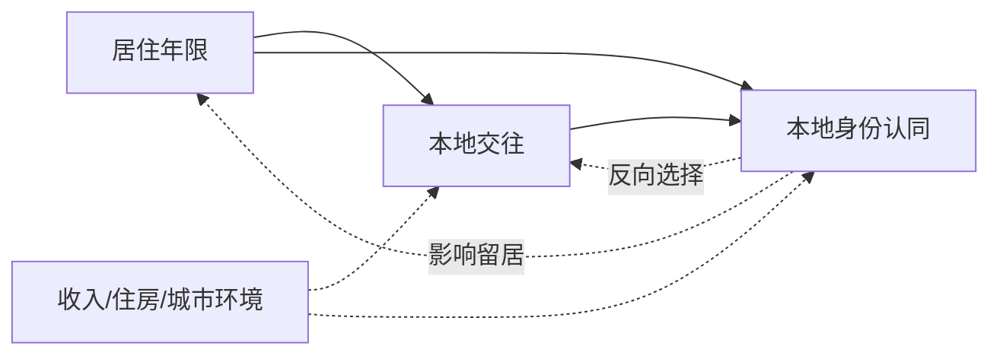
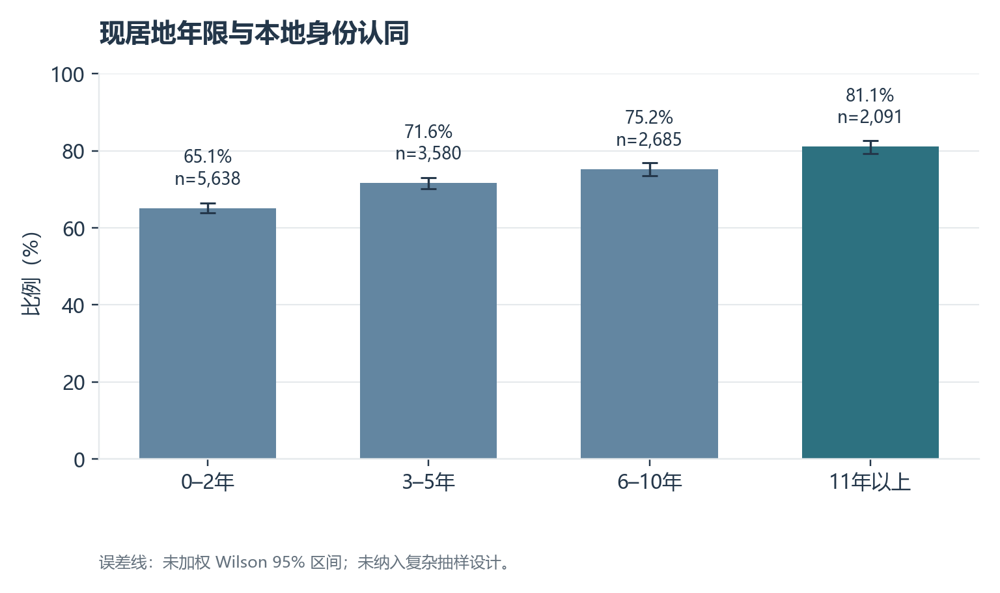
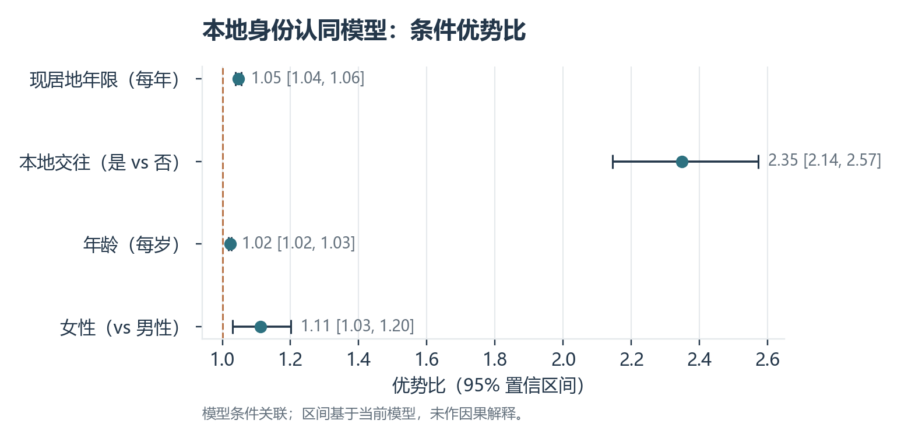
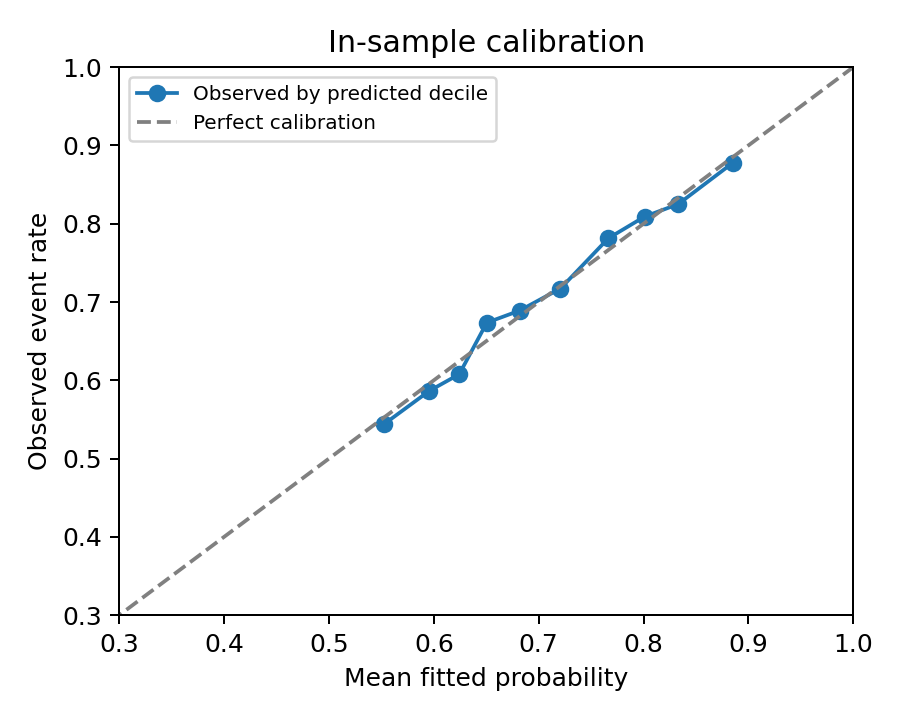
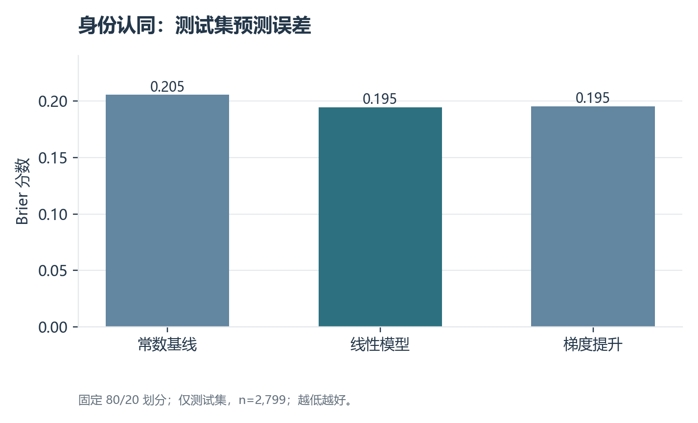

# 居住经历、本地交往与流动人口身份认同：基于 CMDS 2017 的关联、加权与预测研究

**摘要：** 本文利用 CMDS 2017 年 C 卷的 13,994 个完整案例，研究现居地年限、本地交往与“我觉得我已经是本地人了”的身份认同。按居住年限分组，认同比例从 0–2 年组的 65.15% 上升至 11 年以上组的 81.06%。控制年龄、性别与教育后，每增加一年居住时间的优势比约 1.046，与本地人来往最多者的优势比约 2.35。以居住年限和人口学变量估计倾向评分的加权对比仍显示本地交往组认同率较高，但反向选择和未测混杂不能排除。测试集上正则化 Logistic 的 AUC 为 0.647，略优于直方图梯度提升。本文将身份认同界定为城市融入的一项主观维度，不将其推及经济和制度融入。

**关键词：** 流动人口；本地身份认同；社会交往；CMDS；倾向评分

## 一、研究问题

流动人口在迁入地居住越久，是否越可能认为自己是本地人？与本地人的日常交往是否也与这种身份认同相关？本报告用中国流动人口动态监测调查（CMDS）2017 年 C 卷回答这两个描述性问题。城市融入涉及经济、制度、交往和心理等多个方面；本报告主要测量**主观本地身份认同**，不把单个指标等同于完整的城市融入。

## 研究框架与可检验假设

居住时间延长可能增加接触本地社会的机会，本地交往可能关联归属感；已有归属感者也可能更愿意结交本地人并长期留居。教育、年龄、收入、户籍、住房和城市环境等又可能影响交往与认同。本文检验居住年限和本地交往与身份认同的条件关联，而不把“留在当地”与“已融入”混为一谈。



若将“业余时间主要与本地人交往”视为处理，潜在结果对比需要定义清楚何种交往改变、持续多久，以及排除未测混杂与反向选择。横截面问卷无法验证这些条件，且“交往对象”本身可能受身份认同影响。因此加权对比仅说明在已测背景接近时的差异，不能写成“本地交往促进融入”的因果结论。

## 二、数据与变量

数据源为项目附带的 `2017_Migrant_C_desensitized.dta`，位于 `data/CMDS中国流动人口动态监测（STATA+SPSS）/2017 CMDS/2017 CMDS STATA数据-适用14及以上版本/`。同目录及上级目录提供 2017 年调查问卷、变量说明和技术文件。原始 C 卷有 **13,998 条记录、387 个变量**，超过课程要求的 3,000 样本和 10 变量门槛。通过年龄、流动年份和主要分析变量的有效值筛选后，完整案例有 **13,994 人**。

| 概念 | 字段 | 处理口径 |
|---|---|---|
| 本地身份认同 | `Q503H` | 对“我觉得我已经是本地人了”回答“基本同意”或“完全同意”记为 1，其他两项有效回答记为 0 |
| 在现居地年限 | `q101m1y` | 2017 减去本次流动年份；保留 0–70 年，并分为 0–2、3–5、6–10、11 年以上 |
| 本地交往 | `Q309` | 业余时间来往最多者为“其他本地人”或户口已迁至本地的同乡，记为 1；其余有效选项为 0 |
| 年龄 | `q101c1y` | 2017 减去出生年份；保留 15–80 岁 |
| 性别 | `q101b1` | 男、女；对文件中的个别乱码标签作明确映射 |
| 教育程度 | `q101e1` | 分类变量，回归中控制；小学标签乱码作明确修复 |

数据同时包含留居意愿 `Q314`、落户意愿 `Q313` 和个人最终权数 `w_l`，保留在输出样本中供扩展分析。当前图表与模型均**未加权**。年龄和居住年限由年份近似计算，最多可能有不足一年的误差。缺失情况见 [缺失统计](output/missingness.csv)，具体代码见 [分析脚本](analyze.py)。

## 三、变量分布与数据质量

### 数值字段描述统计

下表对最终完整案例计算，`N` 为该字段的有效观测数；`P25`、`P50`、`P75` 分别为第 25、50、75 百分位。二元变量的均值等于取值为 1 的样本比例；有序类别的均值仅为编码描述，不假定相邻选项距离相等。

| 字段 | N | Mean | SD | Min | P25 | P50 | P75 | Max |
|---|---:|---:|---:|---:|---:|---:|---:|---:|
| 年龄（岁） | 13,994 | 35.18 | 10.21 | 15.00 | 28.00 | 33.00 | 42.00 | 80.00 |
| 现居地年限（年） | 13,994 | 5.36 | 5.58 | 0.00 | 1.00 | 4.00 | 7.00 | 56.00 |
| 本地身份认同（0/1） | 13,994 | 0.71 | 0.45 | 0.00 | 0.00 | 1.00 | 1.00 | 1.00 |
| 本地交往（0/1） | 13,994 | 0.32 | 0.46 | 0.00 | 0.00 | 0.00 | 1.00 | 1.00 |
| 女性（0/1） | 13,994 | 0.49 | 0.50 | 0.00 | 0.00 | 0.00 | 1.00 | 1.00 |

原始精度数值见[数值描述统计 CSV](output/numeric_descriptives.csv)。


下表基于 13,994 个完整案例，报告分类变量分布；更细的教育程度分布见 [变量分布表](output/variable_distribution.csv)。

| 变量 | 分类或统计量 | 数值 |
|---|---|---:|
| 居住年限分组 | 0–2 / 3–5 年 | 5,638（40.29%）/ 3,580（25.58%） |
| 居住年限分组 | 6–10 / 11 年以上 | 2,685（19.19%）/ 2,091（14.94%） |
| 认为自己是本地人 | 是 / 否 | 9,951（71.11%）/ 4,043（28.89%） |
| 与本地人来往最多 | 是 / 否 | 4,414（31.54%）/ 9,580（68.46%） |
| 性别 | 女 / 男 | 6,834（48.84%）/ 7,160（51.16%） |

完整案例占原始 C 卷的 99.97%。该高比例仅说明**所选模型字段**缺失较少，不代表问卷所有字段均完整。教育程度以“初中”占比最高（41.55%）；具体分类见 CSV。

## 四、描述性结果

| 在现居地年限 | 人数 | 认为自己是本地人的比例 | 与本地人来往最多的比例 |
|---|---:|---:|---:|
| 0–2 年 | 5,638 | 65.15% | 28.01% |
| 3–5 年 | 3,580 | 71.59% | 31.12% |
| 6–10 年 | 2,685 | 75.23% | 34.90% |
| 11 年以上 | 2,091 | 81.06% | 37.49% |

按居住年限分组，身份认同比例逐步升高。11 年以上组比 0–2 年组高约 **15.91 个百分点**。按交往对象分组，与本地人来往最多者中 **82.69%** 认为自己是本地人；其他交往组为 **65.77%**，相差约 **16.92 个百分点**。这些是样本中的未调整差异。



*图 1. 各组比例、人数和未加权 Wilson 95% 区间；未处理复杂抽样设计。*

## 五、调整后的关联

### 模型设定

令 $Y_i=1$ 表示受访者同意“我觉得我已经是本地人了”，$T_i$ 是现居地年限，$L_i$ 表示与本地人来往最多。估计二元 Logistic 模型：

$$\operatorname{logit}[P(Y_i=1)]=\beta_0+\beta_1T_i+\beta_2L_i+\beta_3\mathrm{Age}_i+\beta_4\mathrm{Female}_i+\boldsymbol{\gamma}^{\top}\mathrm{Education}_i.$$

使用最大似然估计，报告优势比和 95% 置信区间。年限按线性项进入对数优势函数，因此每增加一年对应相同的条件优势比；这是可检验的模型假设。分析未加权，未控制地区和收入等因素，结果不具备因果解释。


以本地身份认同为因变量进行 Logistic 回归，同时纳入现居地年限、本地交往、年龄、性别和教育程度。在这些变量保持相同时，现居地年限每增加一年，对应身份认同的优势比约 **1.046**（95% 置信区间约 **1.038–1.055**，`p<0.001`）。与本地人来往最多者的优势比约 **2.35**（95% 置信区间约 **2.14–2.57**，`p<0.001`）。完整回归系数见 [结果表](output/logit_coefficients.csv)。



*图 2. 条件优势比及 95% 模型置信区间；虚线为优势比 1。*优势比描述相对优势，不能直接理解为概率增加 4.6% 或 135%。

## 六、样本内拟合与标准化预测

| 指标 | 结果 | 含义 |
|---|---:|---|
| McFadden 伪 $R^2$ | 0.0464 | 相对截距模型有一定改善，不能当成线性回归 $R^2$ |
| AUC | 0.649 | 样本内区分身份认同结局的能力有限 |
| Brier 分数 | 0.1943 | 样本内概率预测均方误差 |
| AIC | 16,066.16 | 可用于同一结局、同一样本的模型比较 |

[拟合指标](output/model_fit.csv)、[十分位校准表](output/calibration.csv)和图 2 均来自训练模型的同一批样本，**不是样本外预测评价**。



*图 3. 样本内预测概率十分位与观察比例比较。*

标准化情景预测将所有受访者的某一解释变量统一设为指定值，其他已观测协变量保持原值，再对预测概率求平均：

| 情景 | 平均预测认同自己是本地人的概率 |
|---|---:|
| 现居地年限：2 / 5 年 | 68.48% / 71.23% |
| 现居地年限：10 / 15 年 | 75.50% / 79.33% |
| 与本地人来往最多：否 / 是 | 66.30% / 81.94% |

这些是模型依赖的描述性预测，不能解释为延长居住时间或改变交往对象后的实际效果。对 15 年情景，部分短期居住者的取值被外推至其实际观察范围以外。详细数值见 [标准化预测表](output/standardized_predictions.csv)；未计算情景差的置信区间，也未做外部验证。

## 七、倾向评分加权与可比性诊断

以本地交往为处理变量，使用现居地年限、年龄、性别和教育程度估计倾向分数；按 $T/e(X)+(1-T)/(1-e(X))$ 加权，倾向值预设截在 0.05–0.95。加权均值差用于衡量在这些已测变量上调整后的身份认同差异。HC3 区间未纳入倾向分数估计误差。

| 诊断或结果 | 数值 |
|---|---:|
| 本地交往组 / 其他交往组 | 4,414 / 9,580 |
| 倾向分数第 1 / 99 百分位 | 0.197 / 0.578 |
| 被截尾的观测数 | 0 |
| 处理组 / 对照组有效样本量 | 约 4,120 / 9,362 |
| 最大绝对标准化均差：加权前 → 加权后 | 0.207 → 0.007 |
| 加权认同比例差 | 15.77 个百分点 |
| 条件性 HC3 95% 区间 | 14.25 至 17.29 个百分点 |

就已纳入变量而言，重叠性与平衡较好，见[倾向诊断](output/ipw_diagnostics.json)和[平衡表](output/ipw_balance.csv)。然而良好的**已测变量**平衡不能消除收入、住房、迁移目的和原有归属感等未测混杂，更不能消除身份认同影响交往的反向路径。因此加权差异仍属于调整后的关联。

## 八、独立测试集上的预测比较

以固定随机种子 20261109 按身份认同结局分层，划出训练集 11,195 人、测试集 2,799 人。比较训练集事件率常数预测、正则化 Logistic 回归和直方图梯度提升分类器。模型使用居住年限、本地交往、年龄、性别和教育程度；类别编码只在训练集拟合。

| 模型 | 测试 AUC | 测试 Brier 分数 | 测试对数损失 |
|---|---:|---:|---:|
| 常数基线 | 0.500 | 0.2055 | 0.6013 |
| 正则化 Logistic | **0.647** | **0.1945** | **0.5745** |
| 直方图梯度提升 | 0.644 | 0.1953 | 0.5756 |



*图 4. 同一测试集上的概率预测误差；越低越好。*

结果见 [测试集模型比较](output/holdout_models.csv)。线性模型略优于梯度提升，说明在现有少量变量下，非线性复杂度没有带来稳定收益。AUC 约 0.65 表明个体区分能力有限；单次随机划分也无法代表跨城市或跨年份外推效果。城市融入具有多维性，预测模型不能替代理论上的概念界定。

## 九、结论与局限

在 2017 年 CMDS C 卷样本中，居住时间较长、与本地人来往更多的流动人口，通常更倾向于认同自己是本地人。该结果为讨论社会交往与心理融入提供了线索，但不能证明居住时间或本地交往造成了身份认同变化：本来更认同当地的人也可能更愿意留下、更主动结交本地人。

本分析仅使用一个年份的 C 卷样本；“来往最多”衡量的是主要交往对象，不是交往频率或关系质量；身份认同是单题自报；尚未控制收入、住房、职业、地区等因素，也未纳入调查权重和复杂抽样设计。因此，所列比例是当前样本的描述，不直接代表全国流动人口总体。

## 十、复现与展示建议

在项目根目录依次运行以下命令，以重建主分析及留出集/倾向评分结果：

```bash
/opt/anaconda3/envs/myenv/bin/python 03_流动人口城市融入/analyze.py
/opt/anaconda3/envs/myenv/bin/python src/advanced_analysis.py
```

PPT 可依次展示研究问题、数据与变量、样本处理、居住年限分组图、本地交往差异、调整后关联及局限。讲解时明确区分“本地身份认同”和广义“城市融入”。

## 十一、数据文献与材料

- 中国流动人口动态监测调查（CMDS），[2017 年 A 问卷](<../data/CMDS中国流动人口动态监测（STATA+SPSS）/2017 CMDS/2017年流动人口动态监测调查-A问卷-最终.pdf>)、[2017 年变量说明](<../data/CMDS中国流动人口动态监测（STATA+SPSS）/2017 CMDS/2017变量说明.pdf>)与项目附带的 C 卷脱敏数据。具体题项名称以 C 卷数据标签为准。
- 本报告统计、表格和图形由本目录 `analyze.py` 计算生成。引用本报告结果时应注明“CMDS 2017 C 卷，作者计算，未加权”。


## 十二、方法参考文献

- Rosenbaum, P. R., & Rubin, D. B. (1983). [The central role of the propensity score in observational studies for causal effects](https://doi.org/10.1093/biomet/70.1.41). *Biometrika*, 70(1), 41–55. 本文借鉴倾向评分与协变量平衡的分析框架。
- Hernán, M. A., & Robins, J. M. [*Causal Inference: What If*](https://miguelhernan.org/whatifbook). 本文据此区分潜在结果、识别假设与观察性关联。
- Friedman, J. H. (2001). [Greedy function approximation: A gradient boosting machine](https://doi.org/10.1214/aos/1013203451). *The Annals of Statistics*, 29(5), 1189–1232. 本文的梯度提升预测比较属于该类方法；具体实现使用 scikit-learn 的直方图算法。
