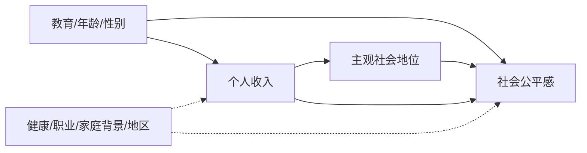
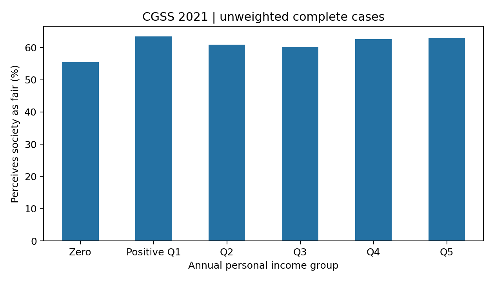

# 个人收入位置与社会公平感：基于 CGSS 2021 的分布、关联与预测研究

**摘要：** 本文使用中国综合社会调查（CGSS）2021 年数据，分析个人收入位置与社会公平感的关系。原始数据含 8,148 名受访者、700 个变量，核心模型的完整案例为 7,264 人。个人收入非负有效值的样本基尼系数为 0.730，但最高 0.5% 收入缩尾后降至 0.645，表明极端值对不平等测度影响较大。零收入组认为社会“比较公平”或“完全公平”的比例为 55.42%，正收入各分位组为 60.11%–63.40%，并无清晰的单调梯度。控制年龄、性别与教育后，对数收入系数虽在全样本显著，但仅在正收入人群中估计或进一步控制主观社会地位后不再显著。测试集上直方图梯度提升模型 AUC 为 0.583，预测能力有限。本文严格区分**收入分布差距**、**个人收入位置**与**社会公平感**三个概念，结果均为观察性关联，不能解释为收入变化导致公平感变化。

**关键词：** 收入分布；社会公平感；CGSS；稳健性分析；机器学习

## 一、研究问题与概念界定

收入差距是群体收入分布的特征，公平感是个人对社会状况的主观判断。单一横截面问卷可计算样本收入分布，并比较不同收入位置的受访者在公平感上的差异；它不能把全国收入不平等的宏观效应与个人收入效应区分开来。本文因此提出两个较窄的问题：CGSS 2021 完整案例中的个人收入分布有何特征？个人收入位置与“社会是否公平”的回答有何关联？

研究预期是低收入者可能更少认同社会公平，但这种关系还会受教育、年龄、主观社会地位及收入报告误差影响。对公平感的回答也可能反过来影响收入报告和工作行为，截面数据无法建立明确时间顺序。



图中的虚线表示当前模型未充分控制的共同因素。主观社会地位可能处于收入与公平感之间，也可能反映未测背景；将其纳入模型只是敏感性分析，不能机械地称作“消除混杂”。

## 二、数据来源、样本与变量

使用项目附带的 `data/CGSS数据合集/CGSS2021/cgss2021stata/CGSS2021.dta`，问卷见同目录 `CGSS2021问卷.pdf`。原始文件有 **8,148 行、700 个变量**，满足课程对样本量和变量数的要求。研究所需变量既包括定量收入、年龄，也包括定性教育、性别与公平感。

| 概念 | 原始变量 | 操作化与编码 |
|---|---|---|
| 社会公平感 | `A35` | 1=完全不公平，2=比较不公平，3=中立，4=比较公平，5=完全公平；二元结局将 4–5 记为 1，1–3 记为 0 |
| 个人年收入 | `A8a` | 2020 年个人全年总收入，非负且小于特殊缺失码 9,999,997 的值有效；0 元保留为独立组 |
| 收入位置 | 由 `A8a` 推导 | 正收入人群按 20%、40%、60%、80% 样本分位点划为 Q1–Q5；零收入单列 |
| 模型收入 | 由 `A8a` 推导 | 对收入在样本第 99.5 百分位（60 万元）缩尾后取 $\\log(1+收入)$；分组表与原始基尼不缩尾 |
| 年龄 | `A3_1` | 2021 减出生年份，保留 18–100 岁 |
| 性别 | `A2` | 1=男，2=女 |
| 教育程度 | `A7a` | 按原始编码合并为小学及以下、初中、高中/中专、大专及以上 |
| 主观社会地位 | `A43e` | 1–5 的有效选项，用于敏感性模型，不进入主模型 |

`A8a` 中“不适用”“不知道”“拒绝回答”的特殊编码视为缺失；`A35` 中 98 和 99 也视为缺失。原始样本中收入无效或缺失 **814 人**，公平感无效或缺失 **58 人**，教育程度缺失 **21 人**。由于缺失可能重叠，完整案例为 **7,264 人**，占原始样本的 **89.15%**。完整处理见[分析脚本](analyze.py)，逐项数量见[缺失表](output/missingness.csv)。

## 三、样本分布与收入差距

下表以 7,264 个完整案例为分母。收入分布高度右偏：均值远高于中位数，标准差也很大。收入数值为受访者自报，可能有回忆、单位和极端值误差。

| 指标 | 数值 |
|---|---:|
| 年龄，均值 ± 标准差 | 52.20 ± 17.22 岁 |
| 个人年收入，中位数 / 均值 | 2.00 万 / 5.26 万元 |
| 个人年收入，标准差 | 35.35 万元 |
| 女性 / 男性 | 3,924（54.02%）/ 3,340（45.98%） |
| 认为社会公平 / 其他有效回答 | 4,408（60.68%）/ 2,856（39.32%） |
| 小学及以下 / 初中 | 2,369（32.61%）/ 2,090（28.77%） |
| 高中/中专 / 大专及以上 | 1,343（18.49%）/ 1,462（20.13%） |

正收入分位的切点约为 **9,600、24,000、40,000、70,000 元**。零收入有 1,449 人，占 19.95%；这可能包含退休、家务、失业及其他情况，不能统一解释为贫困。完整分布见[变量分布表](output/variable_distribution.csv)。

用未加权有效收入计算的样本基尼系数为 **0.730**。将最高 0.5% 收入缩尾后，基尼降至 **0.645**，说明该统计量对尾部申报敏感。两者均非官方全国基尼系数：这里用的是个人总收入、完整案例和未加权样本，口径与按家庭、人口及抽样设计调整的全国收入统计不同。详见[收入敏感性表](output/inequality_sensitivity.csv)。

## 四、收入分组与公平感的描述性关系

| 收入分组 | 人数 | 组内收入中位数 | 认为社会公平的比例 | 公平感均分 |
|---|---:|---:|---:|---:|
| 零收入 | 1,449 | 0 元 | 55.42% | 3.37 |
| 正收入 Q1 | 1,164 | 3,000 元 | 63.40% | 3.54 |
| 正收入 Q2 | 1,237 | 18,000 元 | 60.87% | 3.46 |
| 正收入 Q3 | 1,108 | 30,000 元 | 60.11% | 3.44 |
| 正收入 Q4 | 1,215 | 50,000 元 | 62.63% | 3.49 |
| 正收入 Q5 | 1,091 | 100,000 元 | 62.97% | 3.50 |

零收入组的公平认同比例较低；正收入各组之间并不随收入提高而稳步上升。分位数切点附近有大量相同收入值，故各正收入组人数并非完全相等。数据见[收入分组汇总](output/income_group_summary.csv)。



## 五、统计模型与解释

主模型是二元 Logistic 回归：

$$\\operatorname{logit}[P(F_i=1)]=\\beta_0+\\beta_1\\log(1+I_i^*)+\\beta_2\\mathrm{Age}_i+\\beta_3\\mathrm{Female}_i+\\boldsymbol{\\gamma}^{\\top}\\mathrm{Education}_i.$$

其中 $F_i=1$ 表示认同社会公平，$I_i^*$ 为最高 0.5% 缩尾后的个人年收入。模型以最大似然估计，输出双侧检验和 95% 置信区间。收入对数项系数为 **0.0146**，每增加 1 个对数单位的优势比约 **1.015**（95% 区间 **1.003–1.027**，$p=0.015$）。该效应量很小。由于对数中的 1 与零收入共用同一斜率，单一线性项可能把零收入与正收入的结构差异压缩在同一个系数里。

作为函数形式检查，另以“零收入”为参照加入收入组类别。各正收入组相对零收入组的优势比均为正，但并无稳定的收入梯度；Q3 与零收入组差异在 5% 水平下不显著。请见[主模型](output/logit_coefficients.csv)和[分组模型](output/group_model_coefficients.csv)。这些结果只是在已测变量条件下的关联，不能推出提高个人收入会改变其公平感。

## 六、标准化情景预测与敏感性分析

把所有受访者的模型收入统一设为指定数值，年龄、性别、教育维持原样，再平均模型预测概率。结果是依赖模型形式的描述性情景，并非干预效果。

| 统一设定个人年收入 | 平均预测“认为社会公平”概率 |
|---|---:|
| 0 元 | 57.88% |
| 1 万元 | 61.09% |
| 3 万元 | 61.46% |
| 6 万元 | 61.70% |
| 10 万元 | 61.88% |

从 1 万到 10 万元的模型预测差异不足 1 个百分点；零收入与正收入的差异明显更大。精确值见[情景预测表](output/standardized_predictions.csv)。未对情景差值计算置信区间。

| 模型规格 | 样本量 | 收入对数项优势比 | 95% 区间 | $p$ 值 |
|---|---:|---:|---:|---:|
| 主模型 | 7,264 | 1.015 | 1.003–1.027 | 0.015 |
| 仅正收入者 | 5,815 | 1.011 | 0.965–1.060 | 0.643 |
| 进一步加入主观社会地位 | 7,127 | 1.005 | 0.992–1.017 | 0.459 |

敏感性结果见[模型比较表](output/sensitivity_models.csv)。收入系数对样本范围及协变量设定敏感，不能将主模型的统计显著性解释为稳健规律；主观社会地位也可能是中介，因此第三行仅用于展示模型依赖性。

## 七、独立测试集上的预测比较

按固定随机种子 20261109 对公平感结局分层，将完整案例划分为训练集 **5,811 人**和测试集 **1,453 人**。比较训练集事件率常数预测、正则化 Logistic 模型和直方图梯度提升分类器。三者使用相同的模型收入、年龄、性别和教育变量；数值标准化与类别独热编码仅在训练集拟合。测试集只评价一次，未参与拟合。

| 模型 | 测试 AUC | 测试 Brier 分数 | 测试对数损失 |
|---|---:|---:|---:|
| 常数基线 | 0.500 | 0.2385 | 0.6701 |
| 正则化 Logistic | 0.573 | 0.2352 | 0.6628 |
| 直方图梯度提升 | **0.583** | **0.2332** | **0.6585** |

见[测试集比较](output/holdout_models.csv)。梯度提升略优，但 AUC 仍低，说明仅凭这些背景变量难以预测个人公平感。单次随机划分不能证明跨年份或跨地区的泛化能力。预测模型优化的是误差，不构成因果推断。

## 八、识别边界、局限与结论

本文没有可辩护的外生收入冲击、政策断点或纵向追踪，因此不估计收入变化的因果效应。若定义潜在结果 $F_i(y)$ 为个人年收入设为 $y$ 时的公平感，识别平均效应需要干预的一致性、条件可交换性、正值性和无干扰；收入与健康、职业、家庭资源和社会经历共同决定，这些假设在当前数据中无法验证。更重要的是，个人收入位置不能代表地区或全国不平等环境的因果暴露。

主要局限还有：2020 年收入与 2021 年公平感时间不完全一致；自报收入极端值影响基尼；零收入群体异质；完整案例删除可能造成选择偏差；未使用 `weight_raking` 及复杂抽样设计，不能将比例直接外推为全国总体；二元化公平感丢失了“中立”与“不公平”之间的细节。

在本样本中，零收入组公平认同比例低于多数正收入组，但正收入水平与公平感没有明显单调关系。收入对数项的弱正关联在敏感性模型中不稳定，机器学习预测能力也有限。若希望研究“收入差距是否改变公平感”，更合适的下一步是结合地区与年份层面的收入分布、抽样权重及可识别的外生变化，建立多层或纵向研究设计。

## 九、复现与资料

在项目根目录运行：

```bash
/opt/anaconda3/envs/myenv/bin/python 04_收入差距与公平感/analyze.py
```

脚本生成汇总 CSV、回归结果、敏感性表和图表。为保护调查记录，公开仓库不收录原始 CGSS 数据和逐人分析样本；复现需将获得授权的数据放在上述路径。问卷来源：[CGSS 2021 问卷](<../data/CGSS数据合集/CGSS2021/cgss2021stata/CGSS2021问卷.pdf>)。方法背景参见 Rosenbaum 与 Rubin 的[倾向评分论文](https://doi.org/10.1093/biomet/70.1.41)、Hernán 与 Robins 的[*Causal Inference: What If*](https://miguelhernan.org/whatifbook)；梯度提升模型的理论来源见 Friedman 的[论文](https://doi.org/10.1214/aos/1013203451)。本文未进行倾向评分因果效应估计。
